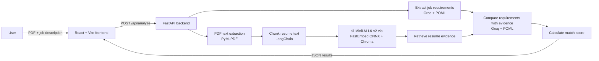

# JobFit RAG

JobFit compares a resume with a job description and returns an evidence-based match report. It extracts requirements from the job description, finds relevant resume passages, classifies each requirement as **SUPPORTED**, **PARTIAL**, or **MISSING**, and calculates a deterministic match score.

## Current application architecture

The current user interface is a React application. It sends the uploaded PDF and job description to a Python API. The API runs the existing retrieval and analysis pipeline and returns a score and requirement-level results. The Groq API key is used only on the Python backend.



Each API request creates a temporary semantic retrieval index for that resume and discards it when analysis finishes. It uses `all-MiniLM-L6-v2` through FastEmbed's ONNX runtime. The API accepts text-based PDF files up to 10 MB. The Vite development server proxies `/api` requests to the local FastAPI server.

## RAG pipeline

The app uses retrieval-augmented generation (RAG) to ground its comparison in the resume instead of asking the LLM to judge the whole document from memory.

1. **Extract resume text:** PyMuPDF reads text from each page of the uploaded PDF.
2. **Split into chunks:** LangChain divides the text into overlapping chunks (1,500 characters with 300 characters of overlap) so relevant details can be found in context.
3. **Embed and index:** FastEmbed runs `all-MiniLM-L6-v2` using ONNX to turn resume chunks into vectors, which Chroma stores temporarily for retrieval.
4. **Extract job requirements:** The job description is sent to the Groq LLM with the POML job analyzer prompt. Requirements are returned in four groups: technical skills, soft skills, experience requirements, and responsibilities.
5. **Retrieve resume evidence:** For each requirement, the app retrieves the three most semantically relevant resume chunks. Experience requirements use the full resume text because dates and career history need broader context.
6. **Analyze matches:** The Groq LLM receives requirements and their retrieved evidence in batches with the POML match analyzer prompt. It classifies each match as `SUPPORTED`, `PARTIAL`, or `MISSING` and explains its decision.
7. **Calculate the score:** Python assigns 1 point to `SUPPORTED`, 0.5 to `PARTIAL`, and 0 to `MISSING`, then converts the total to a percentage.

The retrieval index is discarded after the response is produced; resume chunks are not kept in a persistent database by this API. The first request downloads the embedding model.

## Deployment challenge and design choice

The initial deployment used the Hugging Face `all-MiniLM-L6-v2` embedding model with Chroma for semantic retrieval. On Render's 512 MB free instance, loading the PyTorch-based embedding stack during resume analysis exceeded the available memory and caused the service to restart. Increasing the instance memory would require a paid plan.

To keep semantic search without loading PyTorch or adding another API key, the project now uses FastEmbed's ONNX runtime with the same `all-MiniLM-L6-v2` model. This should use less memory, but the 512 MB Render deployment has not yet been verified with this runtime. Groq handles job requirement extraction and resume-match analysis.

## Technology

- **Frontend:** React, Vite, and Lucide icons
- **API:** FastAPI and Uvicorn
- **LLM:** Groq through LangChain
- **Prompts:** POML
- **PDF extraction:** PyMuPDF
- **Chunking:** LangChain text splitters
- **Retrieval:** `all-MiniLM-L6-v2` via FastEmbed/ONNX semantic search
- **Scoring:** deterministic Python calculation

## Project structure

```text
jobfit_rag/
├── backend/
│   └── main.py                 # FastAPI endpoints and analysis orchestration
├── frontend/
│   ├── src/
│   │   ├── App.jsx             # React upload flow and results report
│   │   ├── main.jsx
│   │   └── styles.css
│   ├── index.html
│   ├── package.json
│   └── vite.config.js
├── src/
│   ├── analysis/
│   │   ├── job_analyzer.py
│   │   ├── match_analyzer.py
│   │   └── match_pipeline.py
│   ├── ingestion/
│   │   ├── chunker.py
│   │   └── pdf_loader.py
│   ├── prompts/
│   │   ├── job_analyzer.poml
│   │   └── match_analyzer.poml
│   └── retrieval/
│       ├── retriever.py
│       └── vector_store.py
├── requirements.txt
├── requirements-render.txt
├── requirements-semantic-local.txt
└── README.md
```

`app.py` is the earlier Streamlit interface. The React application does not use it; start the FastAPI backend and Vite frontend instead.

## Run locally

### 1. Configure the Groq API key

Create or update a `.env` file in the project root:

```env
GROQ_API_KEY=your_groq_api_key
```

Keep `.env` private and do not commit it. If a key was exposed, revoke it and use its replacement here.

### 2. Set up Python

Python 3.12 is recommended. From the project root, create and activate a virtual environment, then install the dependencies:

```bash
python3.12 -m venv .venv
source .venv/bin/activate
python -m ensurepip --upgrade
python -m pip install --upgrade pip
python -m pip install -r requirements-semantic-local.txt
```

This installs FastEmbed, ONNX Runtime, and Chroma for semantic search. If your `.venv` already exists, activate it and run the `ensurepip` and install commands. `ensurepip` restores pip if the environment was created without it.

### 3. Start the API

In a terminal at the project root:

```bash
source .venv/bin/activate
uvicorn backend.main:app --reload
```

The API runs at `http://localhost:8000`. Check that it is available by opening `http://localhost:8000/api/health`; it should return:

```json
{"status":"ok"}
```

Interactive API documentation is available at `http://localhost:8000/docs`.

### 4. Start the React frontend

In a second terminal:

```bash
cd frontend
npm install
npm run dev
```

Open the local URL printed by Vite, usually `http://localhost:5173`. Keep both terminals running. Upload a PDF resume, paste a job description, and choose **Analyze my fit**. The first semantic analysis can take longer while FastEmbed downloads the ONNX model.

## API

### `GET /api/health`

Returns a simple health status for the backend.

### `POST /api/analyze`

Accepts `multipart/form-data` with these fields:

- `resume`: PDF file, up to 10 MB
- `job_description`: job description text

Returns a JSON object with `score` and `results`. Each result includes its category, requirement, match status, explanation, and retrieved resume evidence. Detailed server errors are written to the API terminal; the browser receives a generic error message.

## Deploy

Deploy the React app and Python API as separate services:

1. Create a Vercel project with `frontend/` as its project root.
2. Set the Vercel environment variable `VITE_API_URL` to the deployed API's base URL, for example `https://your-api.example.com`. Redeploy the frontend after changing it.
3. Deploy the Python API from the repository root on Render. Set the build command to `pip install -r requirements-render.txt`, then use this start command:

   ```bash
   uvicorn backend.main:app --host 0.0.0.0 --port $PORT
   ```

4. Set `GROQ_API_KEY` and `FRONTEND_ORIGIN` on the API service. `FRONTEND_ORIGIN` should be the full Vercel origin, for example `https://your-app.vercel.app`, so the API permits browser requests from the frontend.

Do not put provider keys in the frontend or in `VITE_*` variables. Resume processing stays on the backend, and the ONNX model is downloaded on first use.

## Matching and score

For each extracted job requirement, the system retrieves relevant resume text and asks the LLM to compare the evidence with the requirement. The prompts instruct the model to rely on the supplied evidence and not invent experience.

The score is calculated in Python:

```text
SUPPORTED = 1 point
PARTIAL   = 0.5 points
MISSING   = 0 points

Score = (SUPPORTED + 0.5 × PARTIAL) / Total requirements × 100
```

The score is a summary of the analyzed requirements, not a hiring decision. A missing match may mean the experience is absent from the resume or simply not stated clearly.

## Limitations

- Resume extraction currently expects text-based PDFs; scanned documents may not contain extractable text.
- Analysis quality depends on the wording of the job description, resume, prompts, and retrieved passages.
- Large jobs with many requirements can take longer and use more LLM API calls.
- The first analysis may take longer while the embedding model downloads.
- The local Streamlit interface in `app.py` is retained as an earlier version; it is not part of the React/FastAPI flow.
